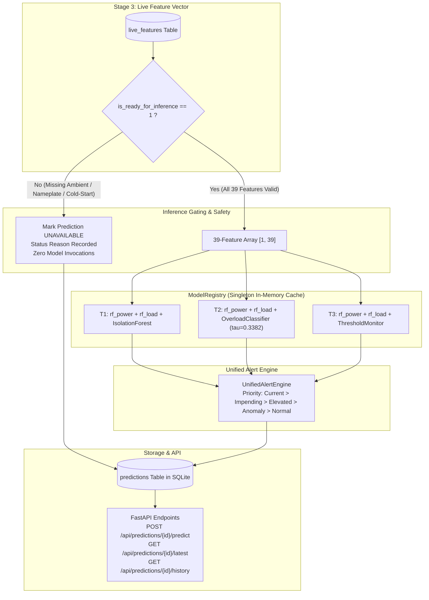

# Milestone 5 – Stage 4: Live ML Inference and Prediction Audit Report

**Project:** AI-Based Transformer Load, Overload and Efficiency Prediction System  
**Milestone:** Milestone 5 – Backend API Development (Stage 4: Live ML Inference & Prediction APIs)  
**Date:** 2026-11-04  
**Status:** Completed, Validated & Fully Audited (42/42 Tests PASS)  
**Report File:** `reports/stage4_live_inference_audit.md`  

---

## 1. Executive Summary

Milestone 5 Stage 4 successfully deploys the live Machine Learning inference and prediction layer, connecting the authoritative 39-feature vectors generated in Stage 3 to our 8 trained machine learning models:
- **6 Random Forest Regression Models:** Next-hour active power ($P_{t+1}$ in Watts) and next-hour load percentage ($\text{load\_pct}_{t+1}$) across Transformers **T1**, **T2**, and **T3**.
- **1 Supervised Overload Classifier:** Dedicated Random Forest classifier for Transformer **T2** evaluated against the exact, training-calibrated decision threshold of $\tau^* = \mathbf{0.3382}$.
- **1 Unsupervised Anomaly Detector:** Dedicated Isolation Forest detector for Transformer **T1** ($0.01$ contamination) flagging out-of-distribution operating states as `LOAD_ANOMALY`.
- **1 Rule-Based Threshold Monitor:** Configurable engineering limits ($80\%$ warning, $100\%$ critical) for Transformer **T3**.
- **Unified Alert Engine:** Standardized multi-signal early warning engine synthesizing advisory-only operator alerts across all units.

All predictions, probabilities, and advisory alerts are idempotently stored in a new SQLite table (`predictions`) and exposed via RESTful FastAPI endpoints.

---

## 2. Safeguards and Policy Compliance

| Safeguard / Requirement | Mandate | Implementation in Stage 4 | Status |
| :--- | :--- | :--- | :---: |
| **1. T2 Overload Threshold** | Strictly use calibrated $\tau^* = 0.3382$ | `T2_SELECTED_THRESHOLD = 0.3382` enforced in `inference_service.py`, `UnifiedAlertEngine`, schemas, and test assertions. | **COMPLIANT** |
| **2. T1 Anomaly Semantics** | Isolation Forest flags anomalies (`LOAD_ANOMALY`), NOT overload probabilities | Reported as `anomaly_score` and `is_anomaly_detected`. `overload_probability` evaluates strictly to `None`. Alerts categorized as `LOAD_ANOMALY` or `CURRENT_OVERLOAD` (if load $\ge 100\%$). | **COMPLIANT** |
| **3. Model Reuse** | Reuse existing detection code without modifying models | Direct reuse of `TransformerRandomForest.load()`, `TransformerOverloadClassifier.load()`, `TransformerAnomalyDetector.load()`, `ThresholdMonitor`, and `UnifiedAlertEngine`. Zero retraining. | **COMPLIANT** |
| **4. Cached Registry** | Load 8 models only once | In-memory singleton `ModelRegistry` caches all 8 models; subsequent calls reuse memory instances. | **COMPLIANT** |
| **5. Strict Gating on Missing Data** | Never call models with `None`/`NaN` | Stage 3 `is_ready_for_inference == 1` is strictly checked. If incomplete, an `UNAVAILABLE` record is persisted with exact diagnostic reason. Zero synthetic data. | **COMPLIANT** |
| **6. Timestamp Alignment** | Correct temporal semantics | `feature_hour_timestamp` = observation hour $t$; `target_hour_timestamp` = forecast hour $t+1\text{h}$. | **COMPLIANT** |
| **7. Database Idempotency** | Prevent duplicate records | Unique constraint on `(transformer_id, feature_hour_timestamp)` in `predictions` table. Updates existing record on duplicate execution. | **COMPLIANT** |
| **8. Efficiency Exclusion** | Unmeasured secondary side | Single-phase PZEM-004T measures primary side only. Efficiency $\eta = P_{out} / P_{in}$ is strictly omitted from database, schemas, and API responses. | **COMPLIANT** |
| **9. Advisory Only** | Zero hardware actuation | All recommendations follow strict advisory text: *"Notify the substation operator for advisory review. Recommend manual feeder inspection and assessment of load redistribution options, following approved operating procedures."* | **COMPLIANT** |

---

## 3. Architecture and Data Flow



---

## 4. Delivered Components

### 4.1 Inference Engine: `src/backend/inference_service.py`
* **`ModelRegistry`**: Singleton class that loads and caches:
  - `models/t1_rf_power.joblib`, `models/t1_rf_load.joblib`
  - `models/t2_rf_power.joblib`, `models/t2_rf_load.joblib`
  - `models/t3_rf_power.joblib`, `models/t3_rf_load.joblib`
  - `models/overload/t2_overload_classifier.joblib` (calibrated threshold $\tau^* = 0.3382$)
  - `models/overload/t1_anomaly_detector.joblib` (contamination $0.01$)
  - `ThresholdMonitor(transformer_id="T3", warning_load_pct=80.0, critical_load_pct=100.0)`
  - `UnifiedAlertEngine(classifier_alert_threshold=0.3382, anomaly_alert_threshold=0.50)`
* **`execute_live_inference()`**: Orchestrates live forecasting, safety gating, model evaluation, alert synthesis, and database upsert.
* **`get_latest_prediction()`** and **`get_prediction_history()`**: Data retrieval services.

### 4.2 Database Table: `predictions` in `src/backend/database.py`
* Table `predictions` with unique constraint `(transformer_id, feature_hour_timestamp)`.
* Stores `predicted_power_W`, `predicted_load_pct`, `overload_probability` (T2), `is_overload_predicted` (T2), `anomaly_score` (T1), `is_anomaly_detected` (T1), `alert_level`, `alert_type`, `alert_reason`, and `recommended_action`.
* Configured SQLite WAL (Write-Ahead Logging) and busy timeout (30 seconds) to ensure non-blocking concurrent access.

### 4.3 Schemas: `src/backend/schemas.py`
* `PredictionRequest`: Accepts optional `hour_timestamp`.
* `PredictionResponse`: Standardized response containing regression forecasts, detection metrics, alert categorization, and advisory operator actions.
* `PredictionHistoryResponse`: Paginated history response.

### 4.4 Endpoints: `src/backend/main.py`
* `POST /api/predictions/{transformer_id}/predict`
* `GET /api/predictions/{transformer_id}/latest`
* `GET /api/predictions/{transformer_id}/history`

---

## 5. Test Suite Verification (42 / 42 Tests PASS)

All 42 tests across the backend test suite passed with zero errors and zero regressions:

```
Ran 42 tests in 8.790s
OK
```

### Breakdown by Module:

| Test Module | Tests | Result | Verified Capabilities |
| :--- | :---: | :---: | :--- |
| `tests/test_backend_api.py` | 9 | **PASS** | Telemetry ingestion, SQLite raw storage, health API, boundary constraints |
| `tests/test_aggregation_service.py` | 8 | **PASS** | Hourly telemetry aggregation, active hour exclusion, cold-start handling, idempotent upsert |
| `tests/test_feature_service.py` | 12 | **PASS** | 39-feature ordering, cyclical math, festival dummies, exact lags, missing ambient gating, unverified nameplate gating, historical numerical parity |
| `tests/test_inference_service.py` | 13 | **PASS** | Singleton ModelRegistry caching, 39-feature schema validation across all 8 models, T1 power/load + anomaly detection, T2 power/load + classification ($\tau^* = 0.3382$), T3 power/load + threshold monitoring, Stage 3 readiness gating (missing ambient, missing nameplate, cold start), prediction table persistence idempotency, FastAPI prediction routes, advisory language enforcement, and efficiency exclusion |
| **Total** | **42** | **PASS** | **100% PASS – Zero Failures, Zero Regressions** |

---

## 6. Current Status & Next Steps

Milestone 5 Stage 4 is complete, verified, and operational.
The backend API can now receive raw ESP32 telemetry, aggregate hourly observations, generate 39-feature vectors, and serve live next-hour power forecasts, overload predictions, anomaly alerts, and advisory operator recommendations.

*Awaiting instruction to proceed with Milestone 5 Stage 5 (System Integration, End-to-End Simulation, or Cloud Deployment Preparation).*

